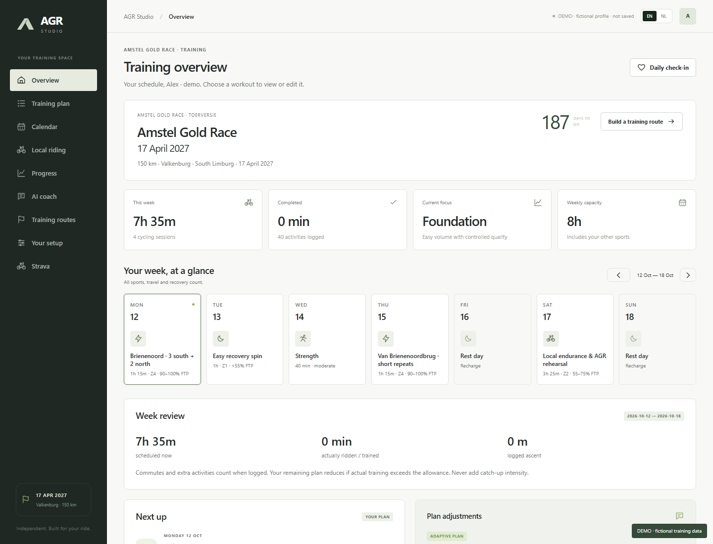
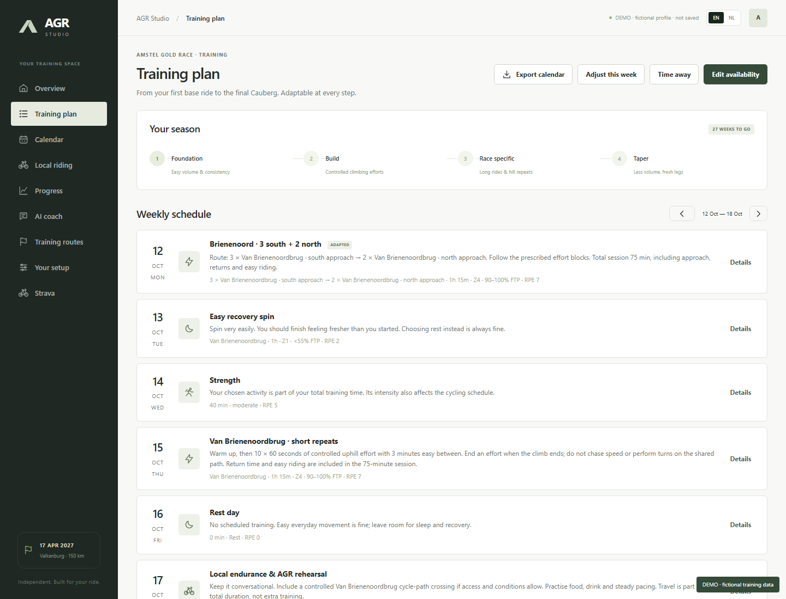
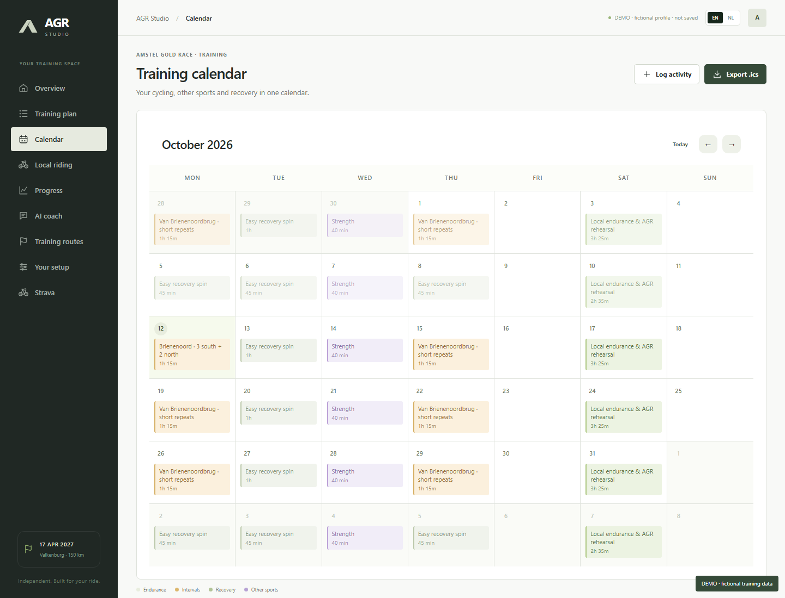
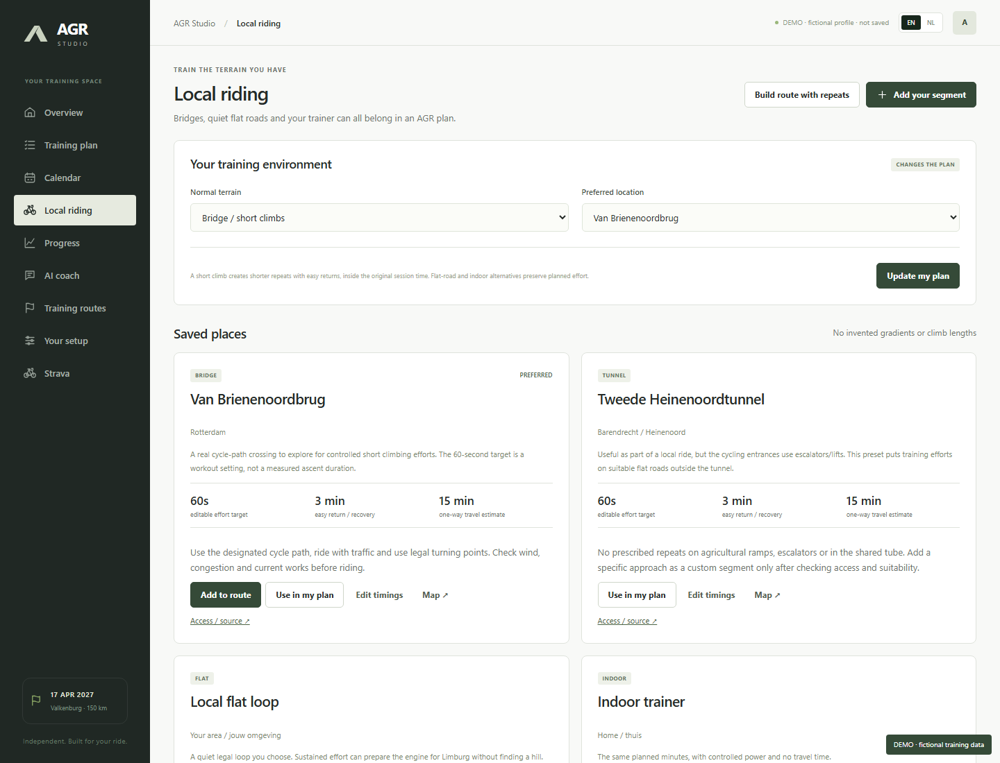
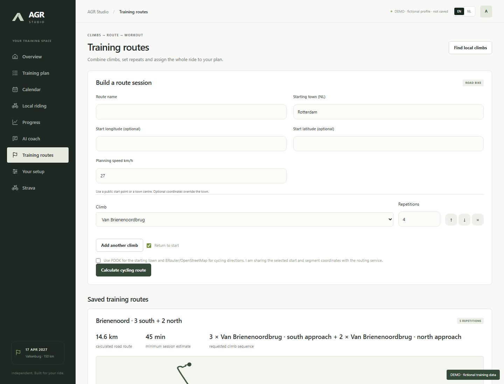
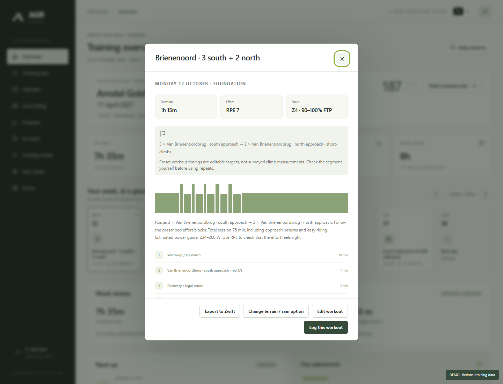
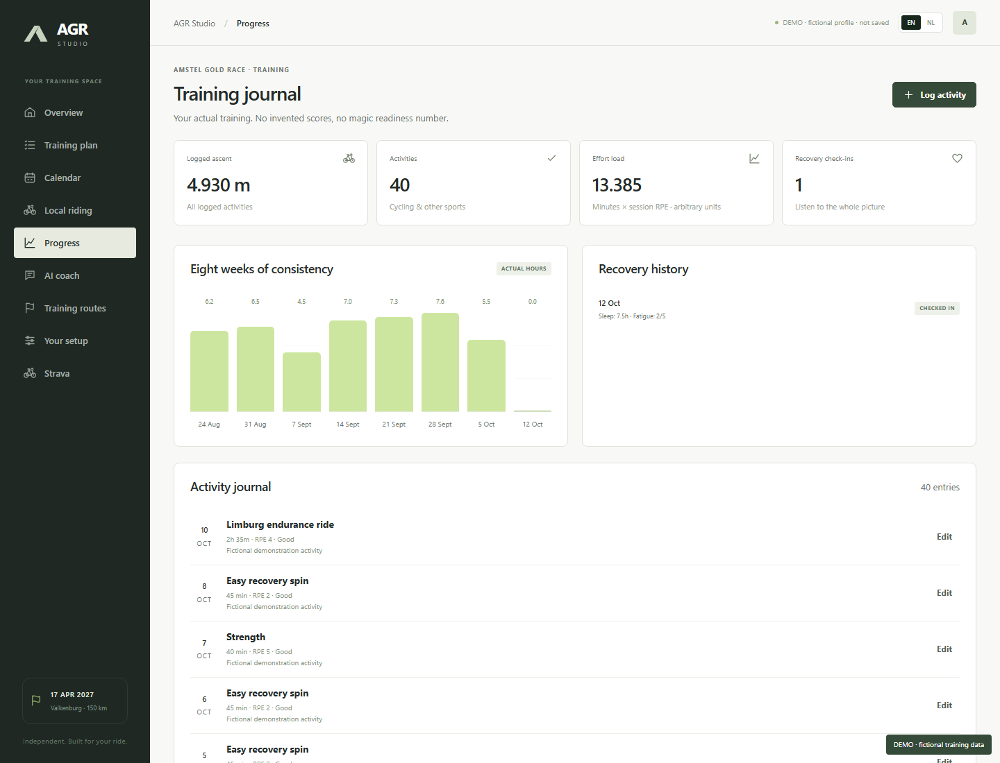
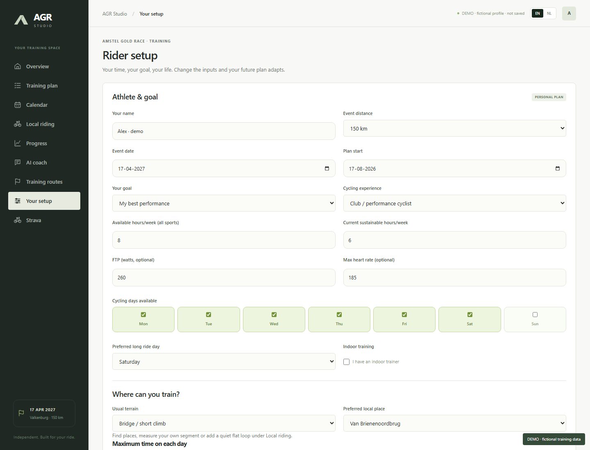
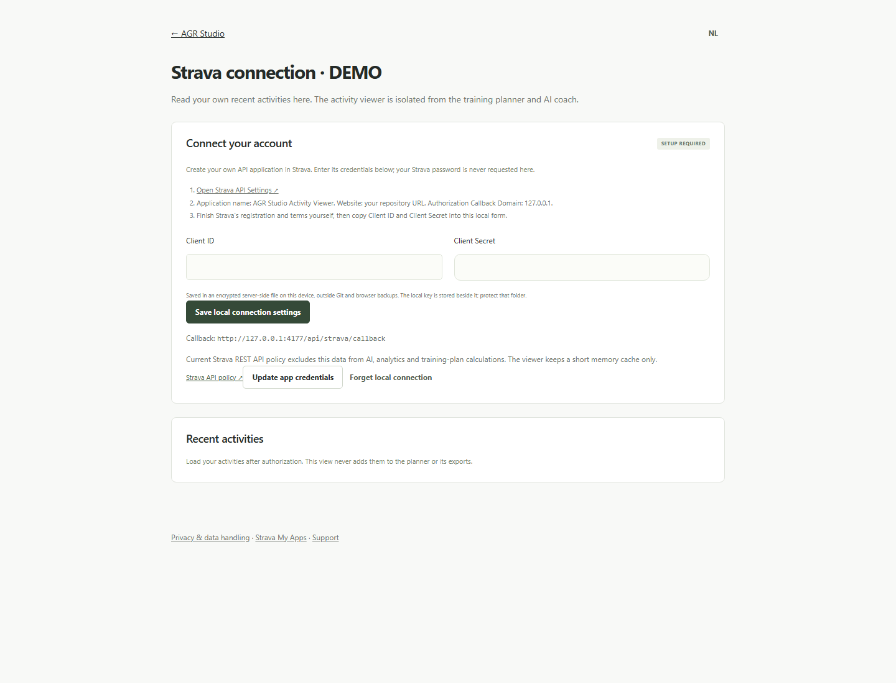
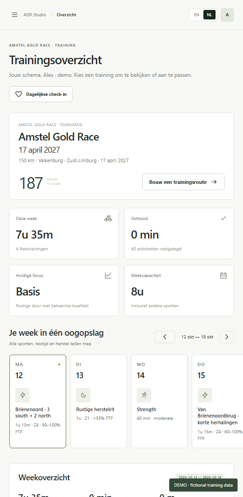

# AGR Studio — 10 screenshots

Actual Chrome renders of the application, captured with an isolated demo profile. Alex and the training journal are fictional. The route uses public mapped cycling endpoints and a real BRouter calculation. No private Strava activities, account credentials or API keys appear in this gallery.

## 1. Training overview

Weekly focus, schedule, recovery and event countdown.

## 2. Adjustable training plan

Sessions arranged around the rider's available time.

## 3. Calendar

Training in its calendar context.

## 4. Local climbing practice

Terrain settings, nearby candidate search and rider-defined segments.

## 5. Training route builder

Climb sequence, repetition counts and road routing.

## 6. Route assigned to a workout

Brienenoord repetitions with structured effort and recovery blocks.

## 7. Training journal

Actual duration, effort and notes from fictional rides.

## 8. Rider setup

Training availability and rider-specific inputs.

## 9. Strava setup

Disconnected demo screen. This deliberately displays no real connection or activities.

## 10. Dutch mobile view

The same training workspace in Dutch on a narrow screen.

